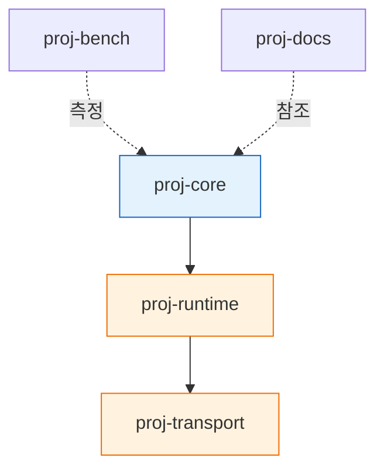

# vela-apps
q-vela application components

# ProjectName

한 문장 목적. (예: 이기종 가속기 기반 분산 추론 서비스 스택)

## 저장소 구성

| Repository | 역할 | 계층 | 언어 | 상태 |
|---|---|---|---|---|
| [`proj-core`](…) | 스케줄러·API 서버 | Control | Python |  |
| [`proj-runtime`](…) | 가속기 런타임 추상화 | Runtime | C++ |  |
| [`proj-transport`](…) | RDMA 전송 계층 | Data | C |  |
| [`proj-bench`](…) | 벤치마크·재현 스크립트 | Tooling | Python |  |
| [`proj-docs`](…) | 설계 문서·논문 자료 | Docs | — | — |

## 의존 관계



실선 = 빌드/런타임 의존, 점선 = 느슨한 참조

## 버전 결속

이 repo는 각 구성요소를 submodule로 고정합니다.

| Submodule | 경로 | 고정 태그 |
|---|---|---|
| proj-core | `components/core` | `v0.4.1` |
| proj-runtime | `components/runtime` | `v0.3.0` |

## 시작하기

```bash
git clone --recurse-submodules https://github.com/org/project-meta.git
cd project-meta && make bootstrap
```

## 기여 시 어느 repo로 갈까?

| 하고 싶은 일 | 대상 repo |
|---|---|
| 새 가속기 백엔드 추가 | `proj-runtime` |
| 스케줄링 정책 변경 | `proj-core` |
| 전송 성능 튜닝 | `proj-transport` |
